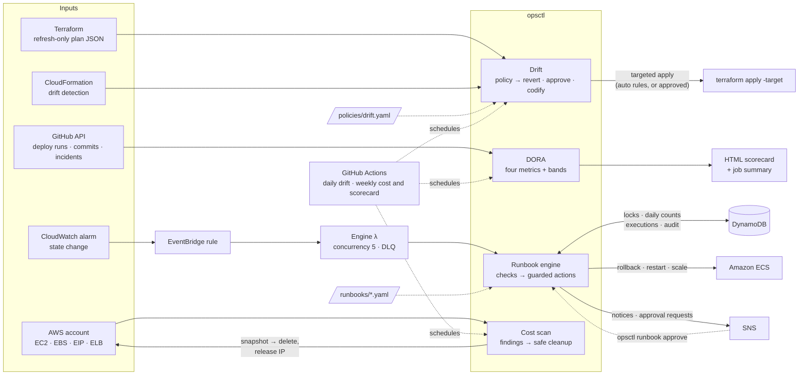
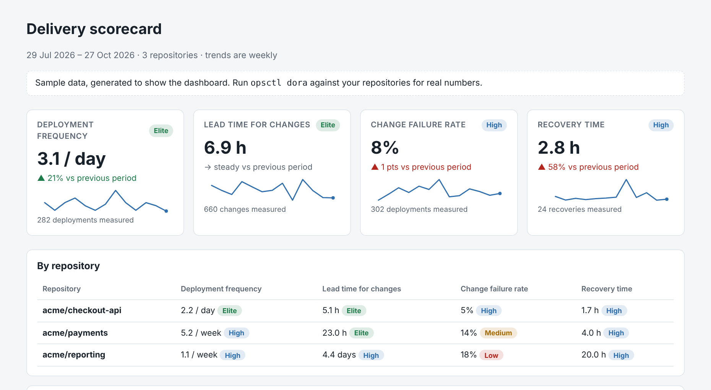

# Ops Automation

[](https://github.com/10vin10-cmd/ops-automation/actions/workflows/ci.yml)

Platform operations that run themselves, within limits a person sets. `opsctl` handles four recurring jobs:

| | What it does | Guardrails |
|---|---|---|
| **[Drift remediation](#drift-remediation)** | Finds infrastructure that no longer matches Terraform or CloudFormation. Classifies it by risk; reverts, asks or reports. | Policy-driven; auto-revert limited per run; protected resources; approvals; dry run by default |
| **[DORA scorecard](#dora-scorecard)** | Deployment frequency, lead time, change failure rate and recovery time from GitHub, as a dashboard | Every definition documented on the page |
| **[Incident runbooks](#incident-runbooks)** | CloudWatch alarms trigger YAML runbooks: check, then roll back, restart or scale | Cooldowns, daily limits, approval gates that re-check, capacity ceilings, audit trail, dry run |
| **[Cost and hygiene](#cost-and-hygiene)** | Unattached volumes, stale snapshots, idle IPs and load balancers, long-stopped instances, missing tags | Dry run by default, `ops:keep` tag, backup before delete, never terminates, action limit |

## Architecture



Each module stays read-only until a guardrail allows it to act: a policy rule marked `auto`, an approval, or `--apply` / `dryRun=false`.

Everything runs offline against a mocked AWS account, with no credentials:

```bash
pip install -e ".[dev]"
opsctl demo          # drift, runbooks, cost and the scorecard, end to end
pytest               # 77 tests
```

> Independent, from-scratch implementation. No proprietary code or configuration.

---

## Drift remediation

Terraform: run a refresh-only plan (it compares state with reality without proposing changes) and hand `opsctl` the JSON. CloudFormation: `opsctl` runs the stack's drift detection itself.

```bash
terraform plan -refresh-only -out=drift.tfplan && terraform show -json drift.tfplan > drift.json
opsctl drift terraform drift.json                     # report and plan (dry run)
opsctl drift terraform drift.json --approve iam-change --apply --workdir infra/
opsctl drift cloudformation my-stack
```

Each drifted resource is matched against [`policies/drift.yaml`](policies/drift.yaml), and the most severe matching rule decides:

| Rule | Severity | What happens |
|---|---|---|
| Security group opened to `0.0.0.0/0` or `::/0` | critical | **revert automatically** |
| S3 public access protection switched off | critical | **revert automatically** |
| Encryption settings changed | critical | **revert automatically** |
| IAM changed outside code | high | revert **after approval** |
| Resource deleted outside code | high | recreate **after approval** |
| Capacity changed by hand (often during an incident) | medium | **codify or undo**: likely deliberate, so a person decides |
| Only tags changed | low | codify or undo |

The guardrails, in order:
1. A resource tagged `ops:drift=ignore` is reported, never touched.
2. CloudFormation drift is a manual action, because redeploying an unchanged template doesn't revert drift.
3. Only rules marked `auto` revert without a person, and at most five per run. A burst of drift is more likely a broken plan than many separate edits.
4. Everything else needs `--approve <address or rule>`.
5. Nothing changes without `--apply`.

The command exits non-zero when something needs a person, so a scheduled run shows up red.

**Example report:** [docs/demo/drift.md](docs/demo/drift.md), from [a refresh-only plan](examples/drift/refresh-only-plan.json) with seven kinds of drift. In it:
- An SSH rule opened to the internet and a disabled public-access block are reverted in one targeted apply.
- An admin policy attached to a role waits for approval.
- A hand-scaled ECS service is flagged as "codify or undo".

## DORA scorecard



```bash
opsctl dora --repo owner/service-a --repo owner/service-b --days 90 --html scorecard.html
```

| Metric | Measured as |
|---|---|
| Deployment frequency | Successful runs of the deploy workflow on the default branch |
| Lead time for changes | Median time from a commit landing on the default branch to the first successful deployment that includes it |
| Change failure rate | Failed deployments, plus successful ones blamed for an incident (an issue labelled `incident` within 24 hours; each incident blames only the latest deploy before it), over all deployments |
| Recovery time | Median of failed deployment → next success, and incident opened → closed |

Bands default to DORA's 2023 performance clusters (elite, high, medium, low) and are configurable. The page is a single HTML file, no scripts, light and dark. It compares with the previous period and shows weekly trends and a per-repository breakdown. A [weekly workflow](.github/workflows/scorecard.yml) builds it for the repositories in `SCORECARD_REPOS`. [Sample dashboard](docs/demo/scorecard.html) (generated data, clearly labelled).

## Incident runbooks

A runbook is YAML: a trigger, a target and steps. Each step is a **check** (read-only) or an **action**, with an optional `when:` condition over earlier results. [`runbooks/ecs-5xx.yaml`](runbooks/ecs-5xx.yaml):

```yaml
trigger: {alarm: "*-5xx", state: ALARM}
target:  {cluster: "${dimensions.ClusterName}", service: "${dimensions.ServiceName}"}
guards:  {cooldown_minutes: 30, max_runs_per_day: 3}
steps:
  - id: service
    check: ecs_service
  - id: rollback                       # deployed in the last hour? roll back
    when: service.last_deploy_age_min < 60 and service.previous_task_definition
    action: ecs_rollback
  - id: restart                        # tasks missing? replace them
    when: not rollback.ran and service.running < service.desired
    action: ecs_restart
  - id: scale_out                      # neither? ask a person before scaling
    when: not rollback.ran and not restart.ran
    action: ecs_scale
    requires_approval: true
    params: {factor: 2, max: 8}
```

| Guardrail | How |
|---|---|
| **Cooldown** | One execution per runbook and target at a time, so a flapping alarm doesn't restart a service five times. In AWS this is a single DynamoDB conditional write, so concurrent invocations can't both act. |
| **Daily limit** | After N runs a day, it stops and tells people: a runbook that keeps firing has stopped helping. |
| **Approval gates** | Risky steps pause and send an approval request. On approval, **the checks run again**, and the step proceeds only if its condition still holds; the system may have changed while waiting. |
| **Ceilings** | Scaling never exceeds the runbook's `max`. |
| **Safe conditions** | `when:` uses a tiny expression language (comparisons, `and`/`or`/`not`, field access), parsed and checked, so a runbook file can't execute code. |
| **Audit trail** | Every check, decision, action, approval and notification, with who and when. |
| **Dry run** | The AWS deployment starts in dry-run mode; acting is opt-in. |

The [demo output](docs/demo/runbooks.md) walks through four cases:
- an automatic rollback after a fresh deploy
- the cooldown suppressing a repeat alarm
- a scale-out pausing for approval
- the same scale-out after approval, with the re-check visible in the audit trail

**In AWS** ([`infra/runbooks_stack.py`](infra/runbooks_stack.py), CDK): an EventBridge rule for alarm state changes triggers the engine Lambda, backed by a DynamoDB table (locks, counters, executions, retained) and an SNS topic (notifications and approvals). It also includes:
- concurrency capped at 5
- a dead-letter queue
- an alarm on the engine's own errors
- ECS permissions scoped to the clusters you name

Runbooks ship as JSON, and the function needs no third-party packages; a test runs the packaged function with PyYAML made unimportable.

```bash
cdk deploy -c clusters=prod -c notifyEmail=oncall@example.com            # dry run
cdk deploy -c clusters=prod -c dryRun=false                              # act
opsctl runbook approve <execution-id> --table <TableName>                # from the approval email
```

## Cost and hygiene

```bash
opsctl cost scan            # report, and what cleanup would do
opsctl cost scan --apply    # clean up what's safe to clean up
```

| Finding | Cleanup |
|---|---|
| EBS volume unattached for 7+ days | snapshot, then delete |
| Snapshot over 90 days old, not backing an AMI | delete |
| Elastic IP not associated | release |
| Load balancer with no targets | report only |
| Instance stopped for 14+ days (its disks still bill) | report only; never terminated |
| Missing required tags (`owner`, `cost-centre`) | report only |

Resources tagged `ops:keep=true` are never touched. A run stops after a configurable number of actions, and one failed action doesn't stop the others. Snapshots whose description names an AMI that still exists count as in use. Savings use approximate list prices (configurable) to size the opportunity, not to predict the bill. [Example report](docs/demo/cost.md).

---

## Scheduled automation

| Workflow | Schedule | Needs |
|---|---|---|
| [`ci.yml`](.github/workflows/ci.yml) | every push | nothing. Runs lint, tests, CDK synth and the demo. |
| [`scorecard.yml`](.github/workflows/scorecard.yml) | weekly | nothing for public repos; `SCORECARD_REPOS` to choose |
| [`drift.yml`](.github/workflows/drift.yml) | daily | `AWS_ROLE_ARN` (OIDC), `TF_DIR`. Reverts only if `DRIFT_AUTO_REVERT=true`. |
| [`cost.yml`](.github/workflows/cost.yml) | weekly | `AWS_ROLE_ARN`. Cleans up only if `COST_CLEANUP_APPLY=true`. |

Workflows that need AWS skip themselves until the variables are set.

## Layout

```
opsctl/drift/       terraform + cloudformation readers, policy, remediation plan, report
opsctl/dora/        metrics, GitHub collector, HTML/Markdown dashboard, sample data
opsctl/runbooks/    engine, actions, safe expressions, stores (memory/file/DynamoDB), Lambda handler
opsctl/cost/        scanner and cleanup
opsctl/cli.py       the `opsctl` command;  opsctl/demo.py  everything against mocked AWS
policies/           drift policy          runbooks/  runbook definitions
infra/              CDK stack for alarm-driven runbooks
tests/              77 tests (moto, botocore Stubber, CDK assertions)
```

## Limitations

- AWS calls are tested against moto and stubbed APIs, not a live account.
- Drift revert relies on `terraform apply -target`, which Terraform itself recommends only for exceptional cases like this one. Review the plan in the report first.
- The DORA collector reads GitHub Actions runs as deployments. Teams that deploy another way need a different collector feeding the same metrics.

## License

MIT
